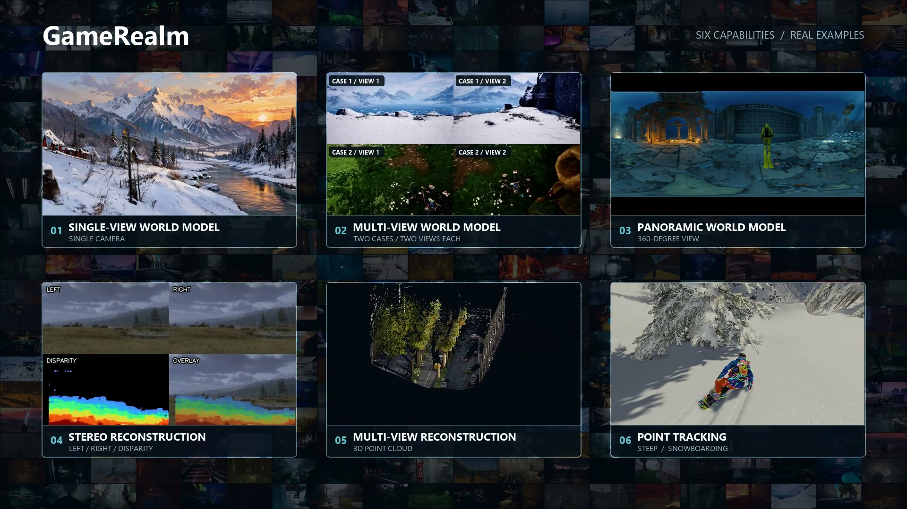

# GameRealm: Grounding Visual Learning in Interactive Games

GameRealm brings visual observations, spatial structure, and interaction signals
from interactive game environments together to support research in world
understanding, including world modeling, 3D reconstruction, and point tracking.

## Project video

[Watch or download the project video](media/teaser.mp4) · 25 seconds
